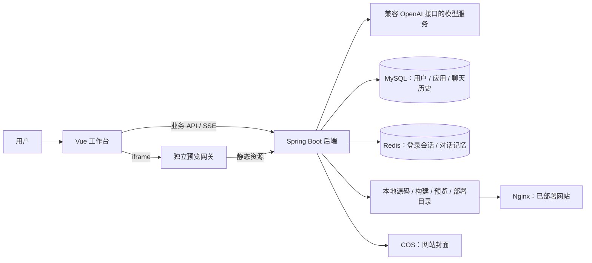

# AI Code Mother · AI 零代码应用生成平台

通过自然语言创建网站，在对话中持续修改，直接预览、下载和部署生成结果。

项目采用 Spring Boot + LangChain4j + Vue 3 的前后端分离架构：后端负责模型调用、代码生成、工程构建、应用管理与部署；前端提供需求输入、流式对话、网站预览、可视化编辑和管理页面。

## 目录

- [核心功能](#核心功能)
- [系统架构](#系统架构)
- [技术栈](#技术栈)
- [项目结构](#项目结构)
- [本地运行](#本地运行)
- [预览与部署](#预览与部署)
- [开发命令](#开发命令)
- [接口与页面](#接口与页面)
- [常见问题](#常见问题)
- [当前实现说明](#当前实现说明)

## 核心功能

### AI 生成与持续迭代

- 根据初始需求调用 AI 选择代码生成类型。
- 支持 `html`、`multi_file`、`vue_project` 三种生成方式。
- 通过 SSE 流式返回生成内容，并在对话页展示生成进度、工具反馈和错误信息。
- 保存应用及聊天记录，支持继续对话修改已有网站。
- 使用 Redis 保存应用对应的模型对话记忆，使用 MySQL 保存可查询的聊天历史。

### 网站预览与编辑

- 生成完成后自动检查并刷新网站预览。
- 独立预览网关提供生成页面和静态资源，支持 Vue 构建产物加载。
- 通过页面元素选择和后续提示词进行可视化修改。
- 父页面通过 `postMessage` 与预览页面交互。

### Vue 工程工具

- 查看目录、读取和修改文件、搜索项目内容。
- 在源码快照中执行类型检查和构建，返回构建日志。
- 发布成功的构建产物作为预览，构建失败时保留上一版已发布预览。
- 工程构建工具支持 Docker 和本地两种执行模式。

### 应用与用户管理

- 用户注册、登录、退出和个人资料展示。
- 查看、搜索、修改和删除个人应用，浏览精选案例。
- 下载应用源码 ZIP，部署生成的静态网站。
- 通过 Selenium 截取部署网站封面，并上传至腾讯云 COS。
- 管理员可管理用户、应用及聊天历史；应用优先级为 `99` 时展示为精选应用。

## 系统架构



一次完整的使用流程：

1. 用户在首页提交需求，后端选择生成类型并创建应用。
2. 前端进入应用工作台，发起代码生成并显示流式回复。
3. 后端保存生成文件；Vue 工程通过构建工具生成和发布静态产物。
4. 前端经预览网关加载网站，用户继续对话或选取页面元素进行修改。
5. 用户下载源码，或部署至 Nginx 托管目录并获取访问地址。

## 技术栈

**后端**：Java 21、Spring Boot 4.1.1、Spring MVC、LangChain4j、Reactor、MyBatis-Flex、MySQL、Redis、Caffeine、Hutool、Selenium、腾讯云 COS、Knife4j / OpenAPI。

**前端**：Vue 3、TypeScript、Vite、Vue Router、Pinia、Axios、Ant Design Vue、Markdown-it、Highlight.js、DOMPurify。

**工程工具**：Maven Wrapper、npm、Docker、Nginx、ESLint、Oxlint、Prettier。

具体依赖版本以 [pom.xml](pom.xml) 和 [前端 package.json](ai-code-mother-frontend/package.json) 为准。

## 项目结构

```text
ai-code-mother/
├── src/main/java/com/xy/aicodemother/
│   ├── ai/                         # AI 服务、生成类型路由、工程工具
│   ├── annotation/                 # 权限注解
│   ├── aop/                        # 权限检查切面
│   ├── common/                     # 统一响应、分页等公共模型
│   ├── config/                     # 模型、Redis、COS、JSON 等配置
│   ├── constant/                   # 目录、部署地址和业务常量
│   ├── controller/                 # 应用、用户、历史、静态资源接口
│   ├── core/                       # 生成门面、流处理、解析、保存和构建
│   ├── exception/                  # 业务异常与全局异常处理
│   ├── manager/                    # COS 等基础能力封装
│   ├── mapper/                     # 数据访问
│   ├── model/                      # 实体、DTO、VO、枚举
│   ├── service/                    # 应用、用户、历史、下载、截图服务
│   └── utils/                      # 网页截图等工具
├── src/main/resources/
│   ├── prompt/                     # 各生成类型及类型路由提示词
│   └── application.yml             # 公共配置，默认启用 local Profile
├── src/test/                       # 后端测试
├── ai-code-mother-frontend/
│   ├── src/app/                    # 页面生命周期和依赖装配
│   ├── src/features/               # 对话、预览、应用、用户等功能模块
│   ├── src/shared/                 # 领域模型、请求适配和公共能力
│   ├── src/api/                    # 根据 OpenAPI 生成的客户端代码
│   ├── src/pages/                  # 路由页面
│   ├── scripts/                    # 预览网关、编辑桥构建和架构检查
│   ├── tests/                      # 前端行为测试
│   └── deploy/                     # Nginx 部署示例
├── sql/create_table.sql            # 用户、应用、聊天历史表初始化
├── tmp/                            # 运行时生成目录，已忽略提交
├── pom.xml
└── mvnw / mvnw.cmd
```

## 本地运行

### 1. 环境准备

- JDK 21。
- MySQL 8.x，默认端口 `3306`。
- Redis，默认端口 `6379`，用于登录会话与模型对话记忆。
- Node.js `^22.18.0 || >=24.12.0`，推荐使用 Node 24。
- 可用的模型服务，需支持聊天、流式输出；Vue 工程生成还依赖工具调用能力。
- 腾讯云 COS 配置。当前后端会在启动时创建 COS 客户端，配置不能直接省略。

部署并生成网站封面还需要 Nginx、Chrome 和可用的 ChromeDriver。驱动由 WebDriverManager 管理，首次运行截图功能时可能需要下载驱动。

### 2. 初始化数据库

在仓库根目录执行：

```bash
mysql -u root -p < sql/create_table.sql
```

脚本创建 `ai_code_mother` 数据库，以及 `user`、`app`、`chat_history` 三张表。已有数据库执行该脚本不会自动迁移已有表结构。

### 3. 创建后端本地配置

创建或修改 `src/main/resources/application-local.yml`。该文件已被 Git 忽略，以下示例通过环境变量读取凭据：

```yaml
spring:
  datasource:
    url: ${DB_URL:jdbc:mysql://localhost:3306/ai_code_mother}
    username: ${DB_USERNAME:root}
    password: ${DB_PASSWORD}
  data:
    redis:
      host: ${REDIS_HOST:localhost}
      port: ${REDIS_PORT:6379}
      ttl: 3600

langchain4j:
  open-ai:
    chat-model:
      api-key: ${AI_API_KEY}
      base-url: ${AI_BASE_URL}
      model-name: ${AI_MODEL}
      timeout: 600s
      max-retries: 1
      log-requests: false
      log-responses: false
    streaming-chat-model:
      api-key: ${langchain4j.open-ai.chat-model.api-key}
      base-url: ${langchain4j.open-ai.chat-model.base-url}
      model-name: ${langchain4j.open-ai.chat-model.model-name}
      timeout: 600s
      log-requests: false
      log-responses: false

cos:
  client:
    host: ${COS_HOST}
    secretId: ${COS_SECRET_ID}
    secretKey: ${COS_SECRET_KEY}
    region: ${COS_REGION}
    bucket: ${COS_BUCKET}

project:
  tools:
    execution-mode: local
    npm-executable: npm
    install-dependencies: true
    command-timeout-seconds: 120
```

在启动后端的终端中设置上述变量，例如：

```bash
export DB_PASSWORD='你的数据库密码'
export AI_API_KEY='你的模型 API Key'
export AI_BASE_URL='https://你的模型服务地址/v1'
export AI_MODEL='你的模型名称'
export COS_HOST='https://你的存储桶访问域名'
export COS_SECRET_ID='你的 COS Secret ID'
export COS_SECRET_KEY='你的 COS Secret Key'
export COS_REGION='你的存储桶区域'
export COS_BUCKET='你的存储桶名称'
```

使用带密码的 Redis 时，还需在配置中添加 `spring.data.redis.password`。IDE 启动后端时，应将这些变量填入对应运行配置。

`local` 模式会在本机执行生成项目的 npm 脚本，适用于可信的本地开发。工程工具默认支持 `docker` 模式，可用 `PROJECT_TOOLS_EXECUTION_MODE=docker` 覆盖，并提前准备 `node:22-bookworm-slim` 镜像。该设置作用于工程工具；当前部署接口中的 `VueProjectBuilder` 仍使用本机 npm 构建 Vue 项目。

### 4. 启动后端

在仓库根目录执行，确保运行时目录位于当前项目下：

```bash
./mvnw spring-boot:run
```

Windows 使用 `mvnw.cmd spring-boot:run`。后端默认端口为 `8123`，Context Path 为 `/api`。

- [Knife4j 接口文档](http://localhost:8123/api/doc.html)
- [OpenAPI JSON](http://localhost:8123/api/v3/api-docs)

### 5. 启动前端

在新的终端执行：

```bash
cd ai-code-mother-frontend
npm ci
npm run dev
```

打开 [本地工作台](http://localhost:5173)，注册并登录账号，然后在首页输入网站需求。

Vite 会同时启动默认端口为 `5174` 的预览网关；直接通过 IDE 启动 Vite 也会启动该网关。主站端口被占用时，以终端输出的实际地址为准。

开发环境中，主站使用 `localhost` 时，预览使用 `127.0.0.1`；主站使用 `127.0.0.1` 时则反向选择。当前预览校验要求主站与预览使用不同主机名。

如需覆盖前端配置，可创建被 Git 忽略的 `ai-code-mother-frontend/.env.development.local`：

```dotenv
VITE_API_BASE_URL=/api
VITE_DEPLOY_DOMAIN=http://localhost
PREVIEW_UPSTREAM=http://localhost:8123
PREVIEW_PORT=5174
```

业务 API 的开发代理目标定义在 `vite.config.ts`。修改后端地址时，需要同时检查 Vite 的 `/api` 代理与 `PREVIEW_UPSTREAM`；后者只控制预览网关的上游地址。

## 预览与部署

### 生成目录

默认目录均相对于后端进程工作目录：

```text
 tmp/
 ├── code_output/
 │   ├── html_<appId>/index.html
 │   ├── multi_file_<appId>/          # index.html、style.css、script.js
 │   └── vue_project_<appId>/         # Vue 源码；兼容读取 dist 构建产物
 ├── project_build/                  # 工程工具使用的构建快照
 ├── code_preview/
 │   └── vue_project_<appId>/         # 发布后的 dist 内容
 ├── code_deploy/
 │   └── <deployKey>/                # Nginx 对外提供的静态文件
 └── screenshots/                    # 截图临时文件
```

### 生成后预览

预览无需先部署网站。前端经独立网关请求 `/api/static/<codeGenType>_<appId>/`：

- HTML 和多文件模式：后端读取 `tmp/code_output/` 中对应应用的文件。
- Vue 模式：优先读取 `tmp/code_preview/vue_project_<appId>/` 中已发布的产物；根入口返回 `404` 时，前端回退到 `/dist/index.html`，读取工程目录中的兼容构建产物。

网关只代理静态内容，不转发用户 Cookie、Authorization 等凭据，并向页面注入可视化编辑桥脚本。

### 本机 Nginx 部署

点击“部署”后，后端将网站复制至 `tmp/code_deploy/<deployKey>/`；Vue 项目会先进行构建，再复制 `dist` 内容。

本机作品站点可采用以下配置。将 `root` 替换为项目部署目录的实际绝对路径，放入 Nginx 已加载的 `server` 配置中：

```nginx
server {
    listen 80;
    listen 8080;
    server_name localhost;

    charset utf-8;
    charset_types text/css application/javascript text/plain text/xml application/json;
    root /absolute/path/to/ai-code-mother/tmp/code_deploy;
    index index.html;

    location ~ ^/([^/]+)/(.*)$ {
        try_files /$1/$2 /$1/index.html =404;
    }
}
```

检查并重新加载配置：

```bash
nginx -t
nginx -s reload
```

作品访问地址形如 `http://localhost/<deployKey>/`。当前后端在 `AppConstant.CODE_DEPLOY_HOST` 中使用 `http://localhost`，前端开发配置的 `VITE_DEPLOY_DOMAIN` 与之对应；更换域名或端口时，两处需要同步调整。

当前部署流程会继续访问作品地址、生成截图并上传 COS，因此后端所在环境也必须能够访问该地址，且 Chrome 与 COS 配置可用。

### 生产部署

平台主站、预览站点与已发布作品应分别配置访问入口。生产前端构建需要设置真实的 `VITE_API_BASE_URL`、`VITE_PREVIEW_BASE_URL` 和 `VITE_DEPLOY_DOMAIN`。

`VITE_PREVIEW_BASE_URL` 只填写独立预览服务的 origin，例如 `https://preview.example.net`，不包含 `/api/static`。生产构建未配置该变量时，前端会显示预览服务不可用。

构建前端和预览编辑桥：

```bash
cd ai-code-mother-frontend
npm ci
npm run build
npm run build:preview
```

在保留 Node 运行依赖的预览服务环境中运行独立网关：

```bash
PREVIEW_APP_ORIGIN=https://app.example.com \
PREVIEW_UPSTREAM=http://backend:8123 \
PREVIEW_PORT=5174 \
npm run preview:gateway
```

上述域名与主机名均为示例。主站反向代理、预览网关代理及 Cookie 隔离要求，参见 [前端 README](ai-code-mother-frontend/README.md) 和 [Nginx 示例](ai-code-mother-frontend/deploy/nginx.conf.example)。示例配置覆盖主站和预览入口，作品站点还需单独配置 `code_deploy` 静态目录。

## 开发命令

后端命令在仓库根目录执行：

```bash
./mvnw test                         # 后端测试
./mvnw clean package                # 打包
java -jar target/ai-code-mother-0.0.1-SNAPSHOT.jar
```

部分集成测试依赖本地服务。真实模型调用测试通过 `RUN_LLM_TESTS=true` 显式启用，运行前需要配置模型服务：

```bash
RUN_LLM_TESTS=true ./mvnw test
```

前端命令在 `ai-code-mother-frontend/` 目录执行：

```bash
npm run dev                        # Vite 主站与独立预览网关
npm run type-check                 # TypeScript / Vue 类型检查
npm run lint                       # 只读 Lint 和架构检查
npm test                           # 行为测试
npm run check                      # 类型、Lint、测试、主站及预览桥构建
npm run build                      # 类型检查并构建主站
npm run build:preview              # 构建预览编辑桥
npm run preview                    # 本地查看已构建的主站
npm run openapi2ts                 # 根据运行中的后端生成 API 客户端
```

`npm run preview` 仅用于查看主站构建结果。运行完整预览服务仍需构建编辑桥、启动独立网关并配置预览地址。

前端功能按 `src/features/` 分模块，生命周期和依赖装配集中在 `src/app/`，公共领域模型位于 `src/shared/`。`src/api/` 为生成代码，架构检查会校验其保护清单；更新 API 客户端时应同步审核生成结果及 `scripts/generated-api.sha256.json`。

## 接口与页面

### 主要后端接口

业务接口通常返回 `code`、`data`、`message`；代码生成使用 SSE，源码下载返回 ZIP，静态预览直接返回文件。

- 用户：`POST /api/user/register`、`/api/user/login`、`/api/user/get/login`、`/api/user/logout`。
- 应用：`POST /api/app/add`、`/api/app/update`、`/api/app/delete`；`GET /api/app/get/vo?id=<appId>`。
- 应用列表：`POST /api/app/my/list/page/vo`、`/api/app/good/list/page/vo`。
- 代码生成：`GET /api/app/chat/gen/code?appId=<appId>&message=<prompt>`。
- 对话历史：`POST /api/chatHistory/app/list/page`。
- 部署：`POST /api/app/deploy?appId=<appId>`。
- 下载源码：`GET /api/app/download/<appId>`。
- 静态预览：`GET /api/static/<codeGenType>_<appId>/...`。

管理员接口位于 `/api/app/admin/`、`/api/chatHistory/admin/` 及用户管理接口下，具体权限、参数和返回值以控制器和 OpenAPI 文档为准。业务 ID 在后端以字符串序列化，前端保留字符串，避免 JavaScript 大整数精度丢失。

### 主要前端页面

- `/`：创建入口、我的作品、精选案例。
- `/app/:id`：应用对话与网站预览工作台。
- `/app/edit/:id`：应用信息编辑。
- `/user/login`、`/user/register`、`/user/profile`：认证与个人资料。
- `/admin/appManage`、`/admin/userManage`、`/admin/chatHistoryManage`：管理员页面。

## 常见问题

### 主站能打开，生成网站无法预览

确认后端 `8123` 和预览网关 `5174` 均已启动。查看前端终端的 `Preview gateway` 日志，并检查对应应用的预览文件是否存在。Vue 项目需要可用的构建产物，源码入口不能直接作为静态构建结果展示。

### 修改预览服务后提示不可用

确认 `VITE_PREVIEW_BASE_URL` 为完整的 HTTP(S) origin，且主机名与主站不同。修改环境变量后重新启动开发服务，生产环境则重新构建。检查 `PREVIEW_APP_ORIGIN` 与主站实际协议、主机、端口一致。

### 本机部署地址返回 404

确认 Nginx 已加载配置、`root` 指向 `tmp/code_deploy` 的绝对路径，并存在 `<deployKey>/index.html`。生成目录中的 `codeGenType_appId` 和部署目录中的 `deployKey` 是不同标识。

### 部署时报截图或上传失败

检查 Chrome/ChromeDriver、COS 参数，以及后端访问作品地址的连通性。部署流程在复制文件和更新应用后仍会执行截图上传，因此应结合错误信息及 `code_deploy` 内容确认失败发生在哪一步。

## 当前实现说明

- 新建应用已调用 AI 选择生成类型，具体逻辑见 `AppServiceImpl.createApp`。
- 网站源码、构建与部署产物保存于本机文件系统，多实例部署需要另行设计文件共享和任务调度。
- COS 当前用于截图封面，网站文件由静态目录提供。
- 工程工具的 Docker 模式与部署接口的本机 Vue 构建是两条执行路径。
- 生成页面应通过独立预览主机承载；主站业务 Cookie、后端访问边界和服务端权限检查需要配合部署配置。
- 仓库尚未声明开源许可证，对外发布前请明确授权方式并补充 LICENSE。
