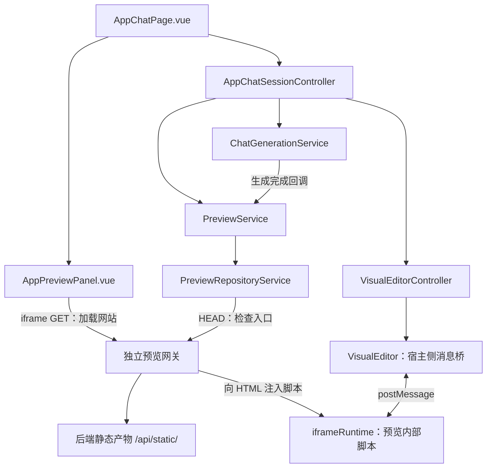

# 前端预览方案与架构分析

分析日期：2026-10-18。

本文基于当前前端源码进行只读分析，梳理预览的模块职责、依赖关系、执行时序、关键代码和实现边界。本次分析未重新执行构建或测试。

当前项目的预览方案可以概括为：**后端生成静态网站，前端检查预览入口，通过独立预览网关将网站加载到 iframe；用户选择页面元素后，再将元素信息补充到提示词，交给 AI 继续修改。**

它包含三项相互配合的能力：

- **预览调度**：决定何时检查、展示和刷新网站。
- **资源访问与隔离**：提供生成产物、处理资源路径、注入编辑脚本。
- **可视化编辑**：在 iframe 内选择元素，通过消息桥把选择结果传回聊天区域。

下面按当前源码展开。代码片段只摘录关键部分。

## 1. 整体结构：工作台负责协调，预览模块负责具体能力

预览相关的主要关系如下：



其中有两个不同的运行环境：

- **主站环境**：Vue 页面、Controller、预览状态、聊天状态、宿主侧编辑桥。
- **预览环境**：生成的网站，以及运行在该网站中的元素选择脚本。

另外还有一个 **Node 预览网关**，负责连接浏览器和后端静态资源。

所以，这套方案既包含浏览器端代码，也包含预览服务脚本。

## 2. 页面与装配层：页面只绑定状态，依赖在统一入口创建

[AppChatPage.vue](../src/pages/AppChatPage.vue) 从会话 Controller 获取公开状态和命令：

```ts
const session = useAppChatSession()
```

页面将这些状态传给预览面板：

```vue
<AppPreviewPanel
  :code-gen-type="app?.codeGenType"
  :has-app="Boolean(app)"
  :has-generated-website="hasGeneratedWebsite"
  :preview-url="previewUrl"
  :preview-error="previewError"
  :is-streaming="isStreaming"
  :is-edit-mode="isEditMode"
  @refresh="showPreview(true)"
  @iframe-ready="setPreviewIframe"
/>
```

这个组件契约比较清晰：

- Props 告诉组件应该显示什么。
- `refresh` 表达用户希望刷新。
- `iframe-ready` 将真实 iframe 元素交给上层绑定编辑器。

页面本身不拼接预览路径，不探测静态文件，也不处理跨窗口消息。

具体依赖由 [controllers.ts](../src/app/controllers.ts) 中的 `useAppChatSession()` 创建：

```ts
stream: new ChatStreamApiClient(),
preview: new PreviewRepositoryService(),
editor: new VisualEditorController(notifier),
```

再交给 `AppChatSessionController` 协调。

这种设计将“创建依赖”和“使用依赖”分开，也为测试替换网络请求、预览仓储和编辑器提供了入口。

## 3. 会话 Controller：决定什么时候展示预览

[AppChatSessionController.ts](../src/features/app-workbench/services/AppChatSessionController.ts) 是整个工作台的协调者。

它创建预览服务：

```ts
const getVersion = () => this.version

this.preview = new PreviewService(
  this.appState,
  getVersion,
  dependencies.preview,
)
```

这里传入了三个依赖：

- `appState`：当前应用，用于获取 ID 和生成类型。
- `getVersion`：当前工作台会话版本，用于识别跨应用的过期结果。
- `dependencies.preview`：构造地址和检查资源的能力。

`PreviewService` 因此不需要读取路由、Pinia 或应用详情接口。

当前有三类自动触发预览的场景。

### 3.1 打开已有对话的应用

Controller 加载首批历史后执行：

```ts
if (page.total >= 2) void this.preview.show()
```

当前实现通过“至少两条历史记录”，推断可能已经进行过一轮用户请求和 AI 回复，再检查预览资源。

注意，**这只是触发检查的条件，不能证明生成成功**。真正有没有静态入口，还要由预览服务探测。

### 3.2 打开没有历史读取权限的应用

在应用详情可以正常读取的前提下：

```ts
if (this.canReadHistory.value) await this.initializeHistory()
else void this.preview.show()
```

这允许用户只读查看作品，不必同时获得聊天历史权限。

工作台路由本身仍要求登录；当前权限策略允许所有者或管理员读取历史，只有所有者能够继续生成。

### 3.3 一轮生成成功结束

生成服务的完成回调是：

```ts
onCompleted: () => {
  void this.preview.show(true)
},
```

传入 `true`，表示本次检查需要刷新入口缓存，并允许针对短暂的 404 进行有限重试。

对于全新应用，Controller 会先加载历史；确认历史为空、当前用户是所有者、存在初始提示词且尚未发送时，才自动发起首次生成。

## 4. 生成状态与预览状态分开：流结束后，聊天立即结束生成态

这一点是当前方案中很重要的设计。

[ChatGenerationService.ts](../src/features/ai-chat/services/ChatGenerationService.ts) 在成功消费生成流后，先执行：

```ts
this.streaming.value = false
this.controller = null
if (completed) this.context.onCompleted?.()
```

随后完成回调才启动预览检查：

```ts
void this.preview.show(true)
```

因此，整个时序是：

```text
接收生成流
→ 生成流正常结束
→ 结束聊天生成态
→ 异步检查预览资源
→ 检查成功后更新 iframe 地址
```

这样，即使静态产物还没有准备好，也不会让聊天一直显示“生成中”。

当前使用的是**生成完成后刷新静态网站**的方式。预览不会随每一段聊天文本逐步重建，也没有为每个生成应用启动一套前端开发服务器或 HMR。

还有一个完成语义需要区分：实际 SSE 客户端要求收到 `event: done` 或 `data: [DONE]` 才视为正常结束；没有结束标记的提前断流会报错。成功 JSON 响应另有兼容分支。相关实现位于 [ChatStreamApiClient.ts](../src/features/ai-chat/api/ChatStreamApiClient.ts)。

## 5. 预览 URL：由应用 ID 和生成类型定位产物，与正式部署地址分开

地址构造入口在 [app.ts](../src/utils/app.ts)：

```ts
export const getPreviewUrl = (
  app: Pick<AppInfo, 'id' | 'codeGenType'>,
  cacheBust = false,
) => {
  if (!app.id || !app.codeGenType) return ''
  const url = getStaticPreviewUrl(app.codeGenType, String(app.id))
  return url && cacheBust ? `${url}?t=${Date.now()}` : url
}
```

最终路径形式是：

```text
<预览 origin>/api/static/<codeGenType>_<appId>/
```

例如：

```text
http://127.0.0.1:5174/api/static/vue_project_123/
```

刷新时：

```text
http://127.0.0.1:5174/api/static/vue_project_123/?t=时间戳
```

时间戳改变入口 URL，使 iframe 重新导航到本轮地址。

预览和部署使用不同标识：

- **预览**：`codeGenType + appId`，访问当前生成产物。
- **正式部署**：`deployKey`，访问已发布作品地址。

所以生成后可以直接预览，无须先点击部署。

[env.ts](../src/config/env.ts) 负责选择预览站点：

- 主站使用 `localhost` 时，开发预览默认使用 `127.0.0.1:5174`。
- 主站使用 `127.0.0.1` 时，默认使用 `localhost:5174`。
- 生产环境需要配置 `VITE_PREVIEW_BASE_URL`，缺少配置时返回空地址，界面显示预览不可用。

项目还拒绝预览地址与主站使用相同 hostname。这个规则比浏览器的同源判断更严格：浏览器按协议、主机和端口判断同源，而本项目连“相同主机名、不同端口”也不允许。[MDN 同源规则](https://developer.mozilla.org/en-US/docs/Web/Security/Defenses/Same-origin_policy)

## 6. 资源访问层：先用 HEAD 检查入口，再返回实际可用地址

[PreviewRepositoryService.ts](../src/features/preview-editor/services/PreviewRepositoryService.ts) 定义了一个很小的能力契约：

```ts
export type PreviewCheckResult = {
  url: string
  ok: boolean
  status: number
}

export type PreviewRepository = {
  getUrl: (app: AppInfo, cacheBust?: boolean) => string
  checkReady: (
    url: string,
    signal?: AbortSignal,
  ) => Promise<PreviewCheckResult>
}
```

这里的 Repository 实际承担的是“定位和检查预览资源”的职责。

检查时使用独立的 `fetch`：

```ts
const options: RequestInit = {
  method: 'HEAD',
  credentials: 'omit',
  cache: 'no-store',
  signal: request.signal,
}
```

它有几个目的：

- `HEAD`：获取响应状态，不读取网页正文。
- `credentials: 'omit'`：探测请求不携带凭据。
- `cache: 'no-store'`：检查当前资源情况。
- `signal`：支持页面离开、重复刷新和超时取消。

这条请求不经过业务 Axios 拦截器。

对于 Vue 项目，当前还有旧产物目录兼容：

```ts
if (
  response.status === 404 &&
  /\/api\/static\/vue_project_[^/]+\/$/.test(preview.pathname)
) {
  preview.pathname += 'dist/index.html'
  url = preview.href
  response = await fetcher(url, options)
}
```

也就是说：

```text
先检查 vue_project_<id>/
→ 只有根入口返回 404
→ 再检查 vue_project_<id>/dist/index.html
```

200、403、500 都不会触发这个路径回退；其他生成类型也没有这条兼容逻辑。

返回结果中的 `url` 很关键：**iframe 使用的是检查后实际成功的地址**。如果旧应用只能通过 `dist/index.html` 访问，最终显示的也会是这个地址。

## 7. 预览服务：管理状态、重试、竞争与错误

[PreviewService.ts](../src/features/preview-editor/services/PreviewService.ts) 是预览业务的核心，持有四项对外只读状态：

- `previewUrl`：最后通过检查的预览地址。
- `previewError`：检查失败的信息。
- `isChecking`：是否正在检查。
- `hasGeneratedWebsite`：当前是否已有通过入口检查的预览。

其中 `hasGeneratedWebsite` 的实际含义更接近“预览入口已通过检查”。它还不能证明整个网站已经正确执行。

`show()` 的主要步骤是：

```text
读取当前会话版本
→ 使上一轮检查失效
→ 构造 URL
→ 开始检查
→ 按条件重试
→ 确认结果仍属于当前应用、当前检查
→ 写入 URL 或错误状态
```

短暂 404 的重试逻辑是：

```ts
let response = await this.repository.checkReady(url, request.signal)

for (
  let attempt = 0;
  cacheBust && response.status === 404 && attempt < 2;
  attempt++
) {
  await delay(400 * (attempt + 1), request.signal)
  response = await this.repository.checkReady(url, request.signal)
}
```

具体行为是：

- `show(false)`：没有这两轮额外重试。
- `show(true)`：只有 404 才最多额外重试两轮。
- 等待时间分别为 400ms、800ms。
- 网络异常、403、500 等不走这条重试逻辑。

每次 `checkReady()` 有 10 秒超时，根入口与旧 `dist` 回退共用这一轮的超时。额外重试会创建新的超时范围，因此整个 `show(true)` 并不是总计只允许 10 秒。

结果写入前有双重校验：

```ts
if (version !== this.getVersion() || !request.isCurrent()) return
```

两个维度分别处理：

- **会话版本**：用户是否已经切换到了其他应用。
- **LatestRequest**：当前应用是否又发起了更新的预览检查。

这与通用 [LatestRequest](../src/shared/async/LatestRequest.ts) 的用法一致，但增加了跨服务共享的应用会话边界。

另外，新一轮检查开始时没有立即清空旧 URL。因此已有预览时，刷新检查期间会继续显示旧网站；成功后更新地址，失败后才清空预览并显示错误。

## 8. iframe 展示层：资源可访问、DOM 存在、编辑桥就绪是三个阶段

[AppPreviewPanel.vue](../src/features/app-workbench/components/AppPreviewPanel.vue) 根据两个条件创建 iframe：

```vue
<iframe
  v-if="hasGeneratedWebsite && previewUrl"
  ref="previewIframe"
  :src="previewUrl"
  sandbox="allow-scripts allow-same-origin allow-forms"
  referrerpolicy="no-referrer"
  title="生成的网站预览"
></iframe>
```

属性的作用分别是：

- `allow-scripts`：允许生成网站和编辑运行时执行脚本。
- `allow-same-origin`：保留预览网站自身的 origin。
- `allow-forms`：允许生成网站提交表单。
- `no-referrer`：加载 iframe 时不发送主站 Referer。

这里的 `allow-same-origin` **不会把不同域名的预览变成主站同源**。当前方案依赖预览本身位于独立站点；同源的嵌入页面同时启用脚本和同源权限，会削弱 sandbox 的隔离效果。[MDN iframe 说明](https://developer.mozilla.org/en-US/docs/Web/HTML/Reference/Elements/iframe#sandbox)

组件通过模板 ref 上报 iframe：

```ts
watch(
  previewIframe,
  (iframe) => emit('iframe-ready', iframe),
  { flush: 'post' },
)

onBeforeUnmount(() => emit('iframe-ready', null))
```

`flush: 'post'` 让上报发生在组件 DOM 更新之后。

但 `iframe-ready` 表示的是**拿到了 iframe DOM 元素**，此时还不能说明网站已经加载完成。

当前实际存在三个阶段：

1. HEAD 成功：静态入口可访问。
2. iframe 加载文档：浏览器加载 HTML、样式、脚本等资源。
3. 收到编辑桥 `READY`：可视化选择通道可以使用。

网站可以正常展示，但编辑桥不可用；入口也可能返回成功，而页面因 JS 或子资源错误显示空白。

## 9. 独立预览网关：提供静态资源、修正路径、注入编辑能力

[scripts/previewGateway.ts](../scripts/previewGateway.ts) 是这套方案里非常关键的一层。

它提供两个主要入口：

```text
/api/static/...          代理生成网站的静态资源
/__preview_bridge__.js   提供可视化编辑运行时
```

网关当前做了这些限制：

- 只允许 GET、HEAD、OPTIONS。
- 只代理规定的静态资源路径。
- 检查路径穿越和异常编码。
- 不向上游转发浏览器 Cookie、Authorization。
- 不向浏览器转发上游 Set-Cookie。
- 拒绝上游重定向。
- 设置缓存、内容类型、嵌入来源及部分浏览器能力限制。
- 对上游请求设置超时，对响应内容设置大小限制。

主站用 HEAD 探测时，网关只返回状态，不处理 HTML 正文。

iframe 随后通过 GET 加载 HTML 时，网关才注入编辑脚本：

```ts
const bridge =
  `<script defer src="/__preview_bridge__.js" data-app-origins="${origins}"></script>`
```

脚本一般插入 `<head>` 内；没有 `<head>` 时前置到文档内容。

这个设计让可视化选择能力由预览基础设施统一提供，无须要求每次生成的网站都自行实现编辑通信。

网关还会修正 HTML 中部分根相对资源路径。比如当前入口位于：

```text
/api/static/vue_project_123/dist/index.html
```

生成 HTML 中：

```html
<script src="/assets/index.js"></script>
```

会被改为：

```html
<script src="/api/static/vue_project_123/dist/assets/index.js"></script>
```

不过，这里使用的是针对 HTML `src`、`href` 的正则处理。它没有完整解析所有资源引用，也不覆盖 CSS `url(...)`、JS 中的动态路径等全部情况，生成产物仍需要使用兼容的资源路径。

开发环境中，当前 [vite.config.ts](../vite.config.ts) 已接入：

```ts
plugins: [vue(), vueDevTools(), previewGatewayPlugin()],
```

[插件](../scripts/previewPlugin.ts)负责网关的启动、重启和关闭，并将 Vite 实际使用的主站端口加入允许来源。

生产环境则分开处理：

- 普通构建生成主站。
- [`build:preview`](../scripts/build-preview.ts) 生成独立编辑脚本。
- [`preview-server.ts`](../scripts/preview-server.ts) 加载脚本并运行预览网关。

编辑运行时会通过 [previewRuntime.ts](../scripts/previewRuntime.ts) 编译为独立普通脚本并包裹在 IIFE 中，不依赖主站 Vue bundle，也避免与生成页面的顶层变量冲突。

## 10. 可视化编辑桥：主站管理状态，iframe 内部读取 DOM

编辑部分分为三层。

[VisualEditorController.ts](../src/features/preview-editor/services/VisualEditorController.ts) 管理主站可观察状态：

```text
isEditMode       是否开启选择模式
isReady          通信桥是否就绪
selectedElement  当前选中元素的快照
```

它负责切换模式、清除选择、准备提示词和清理资源。

[VisualEditor.ts](../src/features/preview-editor/services/VisualEditor.ts) 管理宿主侧通信：

```text
注册 message/load 监听
→ 创建随机 channel
→ 向 iframe 发送 INIT
→ 接收 READY
→ 允许发送 ENABLE、DISABLE、CLEAR
```

握手的关键代码是：

```ts
this.channel = crypto.randomUUID()
this.post('INIT')

this.timer = setTimeout(() => {
  if (!this.ready)
    this.options.onError?.(
      new Error('预览编辑暂不可用，请刷新网站预览重试'),
    )
}, 8000)
```

初始化时会立即握手；iframe 的 `load` 事件触发后还会重新握手，以处理第一次 INIT 早于运行时脚本加载的情况。

主站接收消息时，先校验真实窗口和 origin：

```ts
if (
  !this.iframe ||
  event.source !== this.iframe.contentWindow ||
  event.origin !== this.origin
) return
```

然后再校验协议标记及当前 channel：

```ts
if (
  !isRecord(value) ||
  value.source !== EDITOR_SOURCE ||
  value.channel !== this.channel
) return
```

元素消息还要通过字段类型、长度和坐标检查，相关规则位于 [protocol.ts](../src/features/preview-editor/protocol.ts)。这符合跨窗口通信应校验来源及消息结构的要求。[MDN postMessage 安全说明](https://developer.mozilla.org/en-US/docs/Web/API/Window/postMessage#security_concerns)

iframe 端也会反向检查消息来自父窗口、父站 origin 在白名单内、channel 符合要求。

随机 channel 用于区分当前握手轮次、过滤旧消息；它不能证明生成页面本身可信。主站始终需要将 iframe 视为受限的外部通信方。

## 11. 元素选择与 AI 修改：传递有限快照，不跨窗口持有 DOM

[iframeRuntime.ts](../src/features/preview-editor/runtime/iframeRuntime.ts) 在预览页面内部执行，因此可以访问该文档的 DOM。

开启选择模式后，它会：

- 监听悬浮和点击。
- 绘制悬浮虚线框、选中实线框。
- 在捕获阶段拦截点击和提交，避免点选时触发网站原本的操作。
- 在滚动、窗口变化时重新计算边框位置。
- 在选中节点被移除时，通知主站清除失效选择。

覆盖层使用 `pointer-events: none`，避免覆盖层自己挡住实际目标。

回传的数据是普通快照，类型定义位于 [element.ts](../src/shared/domain/element.ts)：

```ts
export type ElementInfo = {
  tagName: string
  id: string
  className: string
  textContent: string
  selector: string
  pagePath: string
  rect: {
    top: number
    left: number
    width: number
    height: number
  }
}
```

它没有传递真实 DOM 引用，也没有发送整个页面 HTML。

定位时优先使用唯一 ID；没有合适 ID 时，逐层构造带 `nth-child()` 的选择器。复杂、动态 DOM 中的兜底选择器仍可能存在定位歧义。

选中元素后，[VisualEditPromptBuilder.ts](../src/features/preview-editor/services/VisualEditPromptBuilder.ts) 会把选择信息附加到用户消息。

例如用户输入：

```text
把这个标题改成蓝色
```

实际发送给生成接口的内容可能是：

```text
把这个标题改成蓝色

【可视化编辑目标】
{"pagePath":"/api/static/vue_project_123/","selector":"#hero-title","tagName":"H1","textContent":"欢迎访问"}
结合页面路径、选择器与元素文本修改选中元素。
```

这里还有几项细节：

- 没有选中元素时，原样发送用户输入。
- Vue 旧预览路径中的 `/dist` 会被规整，帮助对应源页面。
- 文本摘要先限制为 100 个 Unicode 字符。
- 附加上下文按编码后长度控制预算。
- 超长时压缩路径、文本和定位信息，并标明定位已精简。
- 最终总消息仍受流接口的长度限制。

生成服务会**先构造包含选中元素的提示词，再调用发送后的清理回调**。这样既能带上目标信息，又能在新一轮生成时退出选择状态，避免继续使用旧 DOM 的选择结果。

因此，当前功能是“选中元素，为 AI 提供修改目标”。代码中没有拖拽布局、直接修改文字、调整元素尺寸或将 DOM 直接保存回源码的实现。

## 12. 生命周期和权限：避免切换应用后残留旧网站、旧选择和旧请求

当前清理覆盖了几种不同范围。

### 12.1 切换应用

`loadApp()` 递增会话版本，并重置生成、历史、预览、编辑器等状态。旧应用的异步结果因此不能写入新应用。

### 12.2 重复刷新

`LatestRequest` 取消上一轮检查，并让它的成功结果、错误和结束回调失效。

### 12.3 预览 URL 变化

装配层同步清除编辑状态：

```ts
watch(session.previewUrl, session.resetEditor, { flush: 'sync' })
```

即使 Vue 复用了同一个 iframe 元素，后续文档加载也会通过 `load` 监听重新握手。

### 12.4 页面销毁

Controller 取消请求，编辑桥移除 `message`、`load` 监听和握手计时器；iframe 内部的 `pagehide` 清理选择监听、观察器和覆盖层。

这里也刻意区分了：

- `reset()`：退出编辑、清除临时选择。
- `destroy()`：进一步释放通信监听和关联资源。

### 12.5 可视化编辑权限

可视化编辑的条件比普通预览更严格：

```ts
this.canInteract.value &&
this.history.historyLoaded.value &&
this.preview.hasGeneratedWebsite.value &&
this.dependencies.editor.isReady.value &&
!this.loading.value &&
!this.generation.isStreaming.value
```

即用户拥有生成权限、历史初始化完成、预览入口可用、编辑桥就绪，并且当前不在加载应用或生成代码。

按当前 [权限策略](../src/features/app-management/services/AppPermissionPolicyService.ts)，管理员如果不是应用所有者，也不能继续生成或使用可视化选择来修改作品。

## 13. 架构价值与当前边界

比较合理的地方主要有四点：

- **状态所有权明确**：预览状态由 `PreviewService` 管理，选择状态由编辑 Controller 管理，页面负责绑定。
- **业务与资源访问分开**：预览服务依赖小型 `PreviewRepository` 契约，可以替换网络实现。
- **生成与预览解耦**：静态资源检查不会延长聊天的生成态。
- **跨窗口边界明确**：DOM 操作留在 iframe 内，主站接收有限、经过检查的数据；聊天组件依赖中立的 `ElementInfo` 类型。

同时，当前源码还有几项需要准确理解的边界。

### 13.1 入口检查不能证明网站运行成功

HEAD 200 不会验证所有子资源、JS 执行、页面是否空白，也不会证明编辑桥就绪。当前没有完整的“生成网站运行健康”上报协议。

### 13.2 预览检查状态尚未完整接入界面

Controller 已公开 `isCheckingPreview`，但页面没有传给预览面板。刷新按钮也没有按这个状态禁用；重复刷新依靠请求替换处理。已有预览时，检查期间仍保留旧页面，且编辑条件没有排除这段检查时间。

### 13.3 历史预览触发依赖消息数量

有历史读取权限的用户，需要 `total >= 2` 才自动检查。历史读取失败或只有一条记录时，即使静态文件存在，也不会沿这条分支自动显示，仍可手动刷新。

### 13.4 资源路径兼容属于有限修正

HTML 属性重写覆盖常见入口引用，复杂 CSS、JS 动态资源路径及多页面路由仍需要产物和服务端配合。

### 13.5 当前按主站与预览站隔离

当前没有按每个生成应用分别分配 origin。各应用使用同一个预览站点的不同路径，不能据此认为不同生成应用之间也具备独立的存储和站点隔离。

### 13.6 生产隔离需要部署配置落地

[Nginx 示例](../deploy/nginx.conf.example)明确禁止主站提供 `/api/static`，让生成内容只通过预览站点访问。这是部署示例，无法仅凭源码确认线上已经应用。当前开发 Vite 的 `/api` 代理仍包含静态路径；预览界面使用独立网关，并不等于开发主站已经封闭所有同源静态入口。

### 13.7 历史文档存在过时描述

[refactoring.md](./refactoring.md) 仍写着由 `dev.ts` 独立启动网关；当前源码实际由 Vite 插件管理，`dev.ts` 只是启动 Vite。理解当前行为应以源码和 [README](../README.md) 为准。

### 13.8 已有验证范围

已有的 [聊天与预览测试](../tests/chat-preview.test.mjs) 覆盖首次生成、消息展示、完成后预览调用、Vue 路径兼容及桥脚本编译；[网关测试](../tests/preview-gateway.test.mjs) 覆盖端口变化、脚本注入、资源路径改写、来源限制、凭据不转发和网关生命周期。

这些测试的范围还不能替代真实浏览器中的网站运行、桥握手和真实后端发布流程验证。本次仅阅读相关测试代码，没有重新执行构建或测试。
